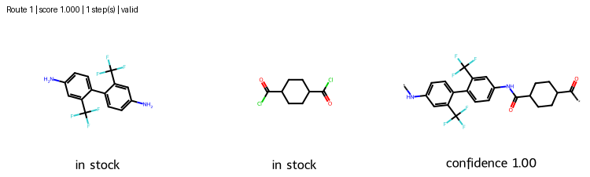

#### Polymer Retrosynthesis:


### Script Execution:
```python
python3 orchestrator.py "[*]Nc1ccc(-c2ccc(NC(=O)C3CCC(C([*])=O)CC3)cc2C(F)(F)F)c(C(F)(F)F)c1"
```

### Output:
```python
Re-checking Claude's 1 step(s) without the LLM
  step 1: Nc1ccc(-c2ccc(N)cc2C(F)(F)F)c(C(F)(F)F)c1 + O=C(Cl)C1CCC(C(=O)Cl)CC1 ->
    *Nc1ccc(-c2ccc(NC(=O)C3CCC(C(*)=O)CC3)cc2C(F)(F)F)c(C(F)(F)F)c1  gate ok  dG=-7.6, dH=-7.7
    kcal/mol  Tc=20775 K
 833.5s  Route is VALID

Route valid=True
  step 1: Nc1ccc(-c2ccc(N)cc2C(F)(F)F)c(C(F)(F)F)c1 + O=C(Cl)C1CCC(C(=O)Cl)CC1 -> *Nc1ccc(-c2ccc(NC(=O)C3CCC(C(*)=O)CC3)cc2C(F)(F)F)c(C(F)(F)F)c1  gate ok  dG=-7.6, dH=-7.7 kcal/mol  Tc=20775 K
```




#### Setup and configuration:
```ini
# Retrosynthesis pipeline settings.
# Each [section] configures one agent. Use plain `key = value` lines.
# Model strings are dspy model names, e.g. anthropic/claude-sonnet-5-5 or openai/gpt-4o.
# model_type: "api" uses the model string through dspy (billed per token); "subscription" runs the
# local `claude` CLI with its login instead, and the model string is ignored.

[predictor]
# Agent 1: template-free single-step predictor. This is the only agent that calls an LLM.
model = anthropic/claude-sonnet-5-5
model_type = subscription
max_tokens = 4000
k = 5

[search]
# Agent 2: tree expansion. It calls the predictor, so it has no model of its own.
max_depth = 4
beam = 3
max_routes = 10

[renderer]
# Agent 4: RDKit drawing. Output directory and size of each molecule image in pixels.
out_dir = retro_routes
width = 250
height = 200

[validator]
# Agent 5: validates each reaction step, including monomers -> polymer repeat unit ([*] end points).
# The LLM calls tools: repeat-unit check, mass balance, and energies from the backend.
# criterion: comma-separated; every listed change must be below zero. dg and dh need backend = gfn2.
enabled = true
model = anthropic/claude-sonnet-5-5
model_type = subscription
max_tokens = 4000
max_iters = 1

[orchestrator]
# Claude as a tool-calling agent: proposes monomers and reaction steps, validates each step with the
# [validator] gate and energies (backend and criterion come from [validator]), and revises failed steps.
model = anthropic/claude-sonnet-5-5
model_type = subscription
max_tokens = 8000
max_iters = 20
```


